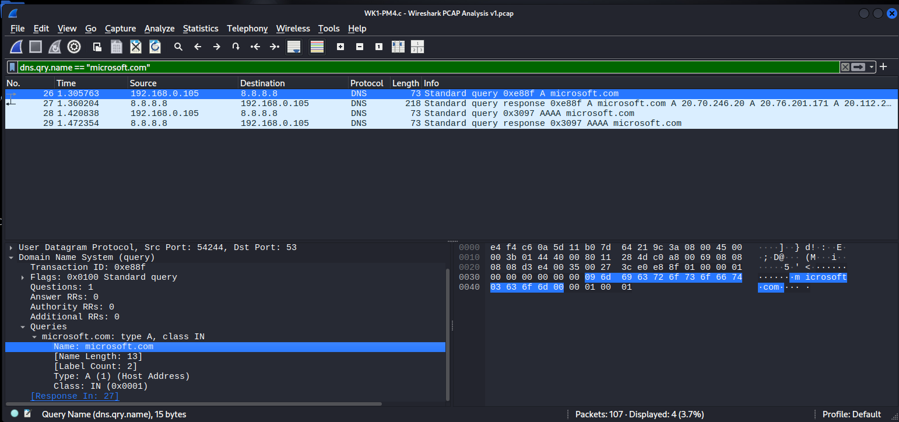

# NETWORKWALKS – WK1-PM4 (c): Wireshark PCAP Analysis

**Name:** Nnani Ifeanyi  
**Batch:** B084  
**Programme:** NETWORKWALKS Cybersecurity & Ethical Hacking Internship  

## Objective

Open a saved PCAP file taken from a laptop that visited **microsoft.com** and read the DNS and TLS information from it, without having been on the network at the time.

## Tools

- Wireshark
- PCAP file: `WK1-PM4.c - Wireshark PCAP Analysis v1.pcap` (107 packets)

## Steps

1. Opened the PCAP in Wireshark with **File > Open**.
2. Applied the display filter below. It returns four packets: an A query and its response, and an AAAA query and its response.

   ```
   dns.qry.name == "microsoft.com"
   ```

   In the first query, the source is the laptop and the destination is the DNS server.
3. Opened the A response and expanded **Domain Name System (response) > Answers** to list every IP address returned for microsoft.com. The AAAA response contains no answer.
4. Applied this filter, selected the Client Hello with `SNI=microsoft.com`, and read the server name and the TCP destination port:

   ```
   tls.handshake.type == 1
   ```
5. Applied this filter and picked the Server Hello coming from the website IP to read the TLS version in the Protocol column:

   ```
   tls.handshake.type == 2
   ```

## Screenshot

DNS queries and responses for `microsoft.com`:



## Answers

| # | Question | Answer |
|---|----------|--------|
| 1 | IP address of the laptop that took the capture | `192.168.0.105` |
| 2 | IP address of the DNS server | `8.8.8.8` |
| 3 | IP addresses returned for microsoft.com | `20.70.246.20`, `20.76.201.171`, `20.112.250.133`, `20.231.239.246`, `20.236.44.162` |
| 4 | Server Name sent in the TLS Client Hello | `microsoft.com` |
| 5 | Server port for the secure connection | `443` |
| 6 | TLS version used by the website | `TLSv1.3` |

## What I learned

- A PCAP lets an analyst reconstruct what happened on a network after the fact.
- One domain can return several IP addresses (here five), which is common for large, load-balanced services.
- The IPv6 (AAAA) query returned no answer, so the connection used IPv4.
- The same filters work on a saved capture as on a live one, which makes PCAP analysis a core skill for SOC and incident investigation work.
